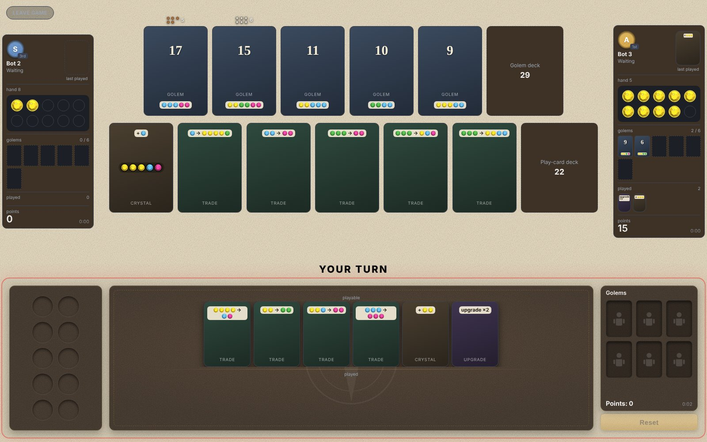

# Century: Golem Edition — multiplayer, simulation environment, and learning the best ways to win

An online version of the board game *Century: Golem Edition*, built to solve two
current goals (and more in the future):

1. **Play online with friends.** This was the initial goal. My friends and I
   routinely played this in our last semester of college. Now that we've
   graduated and moved apart, I wanted to carry on this tradition of fun by
   building a real-time multiplayer web app with rooms, reconnects, practice
   bots and an interactive tutorial.
2. **Train bots to discover the best ways to play the game.** Currently, there
   are two AI tracks on the same rules engine: an interpretable bot tuned over
   ~49,000 simulated games, and a search-based solver that finds near-optimal
   plans for single-player games and proves bounds on them.



---

## What's in it

| Part | What it does | Stack |
|---|---|---|
| **Rules engine** (`engine/`) | Every rule of the game, all 81 cards, legal-move generation, cloning for search | Python |
| **Game server** (`server/`) | Rooms and lobby, one authoritative game per room, validates every move, reconnects, bot opponents, guided "watch the best plan" rooms | FastAPI, WebSockets |
| **Web client** (`web/`) | Full board for 2–5 players: drag crystals to pay, upgrade and trade dialogs, turn clock, tutorial | React 18, Vite |
| **Bots** (`bots/`) | A bot that scores moves with 12 named features, tuned by [evolutionary search](https://en.wikipedia.org/wiki/Evolutionary_algorithm) ([CMA-ES](https://en.wikipedia.org/wiki/CMA-ES)), then taken apart to see which features matter | Python, CMA-ES |
| **Solver** (`solver/`) | Fewest turns to win a solo game: branch and bound, admissible lower bounds, beam search, an integer-programming bound | Python, SciPy (MILP) |

About **700 automated tests** cover the engine, server, bots and solver.

## What the AI found

The full write-ups, with every number traced to a results file, are
[`results/REPORT.md`](results/REPORT.md) (bots) and
[`results/solver_study.md`](results/solver_study.md) (solver).

Here is what the results have shown so far. This section will continue to be
added to as the research progresses.

### 1. From the tuned AI bot

- **Opponent-specific features don't help.** We found that not having any
  opponent-specific features in the model worked best. Four separate
  experiments (removing the opponent term, five opponent-modelling features,
  one-move lookahead, more players) found no measurable gain from watching the
  other player.
- **Ending the game beats scoring well.** The game ends on a *count* of golems,
  so cheaper golems now beat expensive ones later. We found that a "rush" bot
  beat a "big card" bot 62.5% to 37.5%.
- **A magenta crystal is worth about 2.3 yellows**, not the ~11× its place in
  the upgrade chain suggests. Two unrelated methods (tuned weights and direct
  win-rate experiments over 3,000 games each) agree.

### 2. From the single-player solver

- **Build first, then claim fast.** Near-optimal solo plans claim their first
  golem *later* than the bot (turn 12 vs 8) but win 10 turns sooner on average
  (33 vs 43 turns over 500 deals).

### Additional notes

- Win rates for the tuned bots come with 95% confidence intervals, seat
  rotation and positive/negative controls. Rejected ideas are reported too:
  18 candidate features were screened over 144,000 games, and all were
  rejected, including the opponent-focused features.
- In terms of provable bounds for the single-player solver, proving a full game
  optimal would take 10¹⁰–10¹³ states, so the solver reports a *bracket* per
  deal: an admissible lower bound and a replayed winning plan. On small goals
  where the optimum can be proven, the beam-search plans are within 0.1 turns
  of it.
- Optimizations including cheaper cloning, per-card caching and a seen-state
  table cut the late-game benchmark from 244 s to ~40 s, making computation
  more manageable.

---

## Run it

Needs Python 3.10+ and Node 18+.

```bash
# Python dependencies (engine, server, bots, solver, tests)
pip install -r requirements.txt

# Game server, on port 8000
cd server && python -m uvicorn main:app --port 8000

# Web client, in a second terminal (opens on http://localhost:5173)
cd web && npm install && npm run dev
```

Click **Practice solo** to play against bots, or create a room and share the
code. For friends on another network, expose port 8000 (e.g. a Cloudflare
tunnel) and start the client with `VITE_SERVER_URL=wss://<your-host> npm run dev`.

Room code **`TEST`** starts a guided solo game that highlights each move of the
solver's best plan for that deal.

```bash
# Tests
python -m pytest -m "not slow"

# A bot tournament, and the report built from all recorded results
python -m bots.arena --bots tuned_split greedy --players 2 --games 1000
python -m bots.make_report

# The solver: turn-by-turn log of the best plan found for deal 15
python -m solver.replay_log 15
```

---

## Repository layout

```
engine/    rules engine, card data, game tracer, card-art tools
server/    FastAPI + WebSocket game server, practice bots, tutorial, guided rooms
web/       React client
bots/      feature-based bot, simulator, tournaments, CMA-ES tuning, tuned weights
solver/    solo solver: bounds, branch and bound, beam search, studies
results/   the measurements behind every claim, and the reports built from them
docs/      design docs, wire contract, project handover, mockups
```

## Notes

- **Card art and avatars are not included.** The version I play with friends
  uses custom card art made from photos of friends, and avatar photos of them.
  Those stay private, so this repo draws each card from its data (cost, effect,
  points) and uses coloured letter circles for avatars, as in the screenshot.
  The art pipeline is documented in
  [`docs/CARD_ART_HANDOVER.md`](docs/CARD_ART_HANDOVER.md).
- *Century: Golem Edition* is designed by Emerson Matsuuchi and published by
  Plan B Games. This is an unofficial fan project for personal use and study,
  not affiliated with or endorsed by the publisher. Game names and rules belong
  to their owners.
